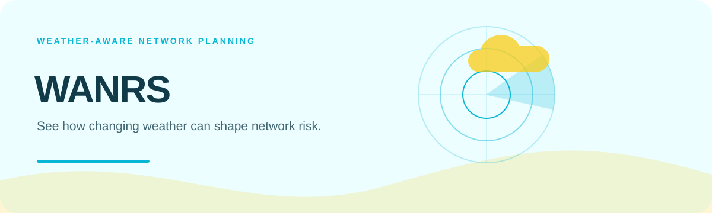
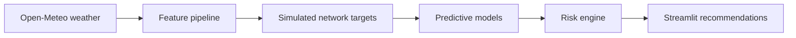

    

<strong>A Streamlit decision-support prototype combining Open-Meteo conditions with simulated network metrics and predictive models.</strong>

## Overview

A Streamlit decision-support prototype combining Open-Meteo conditions with simulated network metrics and predictive models.

### Why it matters

WANRS makes environmental resilience easier to explore by connecting weather observations to interpretable risk levels and recommended network actions.

## Key features

- Live and historical Open-Meteo ingestion
- Rule-based simulation for multiple network types
- Model-backed metric predictions
- Risk classification and response recommendations

## Architecture

## Technology stack

**python** · **streamlit** · **open meteo** · **scikit learn** · **tensorflow**

## Getting started

Install `requirements_txt.txt`, train or provide the expected model artifacts, then run `streamlit run app.py`. Network targets are simulated; the app does not ingest live network telemetry or apply changes automatically.
