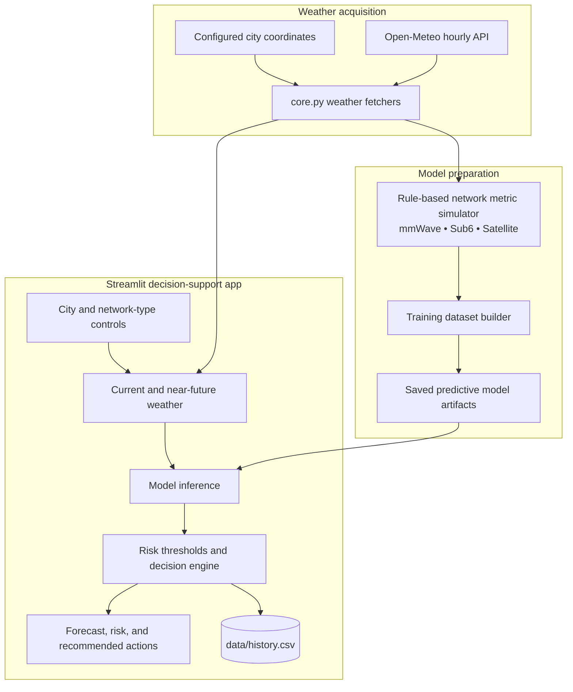

# Weather-Aware Network Resilience System

**Weather-informed network risk exploration and response recommendations**

## Overview

WANRS is a Streamlit decision-support prototype that combines Open-Meteo weather observations with simulated network impairment data. It predicts possible changes in throughput, latency, and packet loss, classifies risk, and presents recommended responses for different network technologies.

### Why this project matters

Weather can affect radio and satellite communication in different ways. WANRS brings weather features, simulated network behavior, and model-backed risk estimates into a single environment for exploring resilience decisions.

## Key capabilities

- Retrieves current and historical weather observations from Open-Meteo.
- Simulates network impairment scenarios for mmWave, sub-6 GHz, and satellite connections.
- Trains and loads random-forest and gradient-boosting models for network metrics.
- Uses an LSTM workflow for sequence-based future estimates.
- Converts predicted impairments into risk levels and recommended actions.
- Shows history and predictions through a Streamlit interface.

## System architecture




### How it works

The weather module requests environmental variables for supported locations. Simulation rules generate the training targets for network impairment. Predictive models consume the weather and connection-type features, then the risk engine interprets the estimated metrics.

The interface supports scenario exploration and presentation of recommended actions. It does not connect to live routers or execute network remediation.

## Technology stack

| Technology | Purpose |
| --- | --- |
| **Python / pandas** | Weather ingestion and transformations |
| **Open-Meteo / requests** | Weather observations and API access |
| **scikit-learn** | Ensemble regressors for network indicators |
| **TensorFlow / Keras** | Sequence forecasting with LSTM |
| **Streamlit / Plotly** | Interactive risk dashboard |
| **CSV / joblib** | History and serialized artifacts |

## Repository structure

```text
app.py               Streamlit dashboard and prediction UI
core.py              Weather, simulation, risk, and history logic
train_models.py      Model training and persistence
models/              Required saved-model artifacts
data/                Local network-weather history
requirements_txt.txt Python dependencies
readme_wanrs.txt     Existing project notes
```

## Getting started

```bash
python3 -m venv .venv
source .venv/bin/activate
pip install -r requirements_txt.txt
python train_models.py
streamlit run app.py
```

## Notes and prerequisites

Network targets are generated by rules rather than measured from operating infrastructure. Internet access is needed for Open-Meteo requests. Treat recommendations as demonstration outputs, not instructions for a production network.
